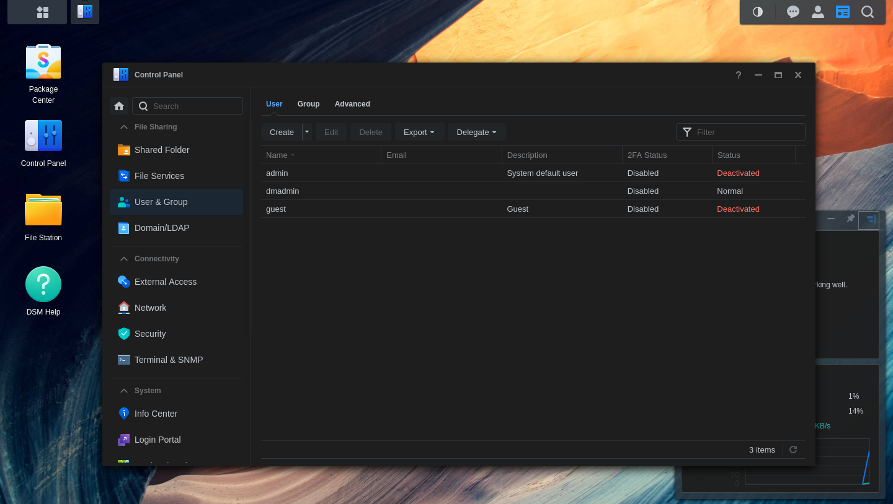
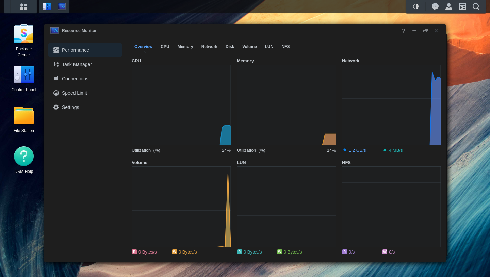
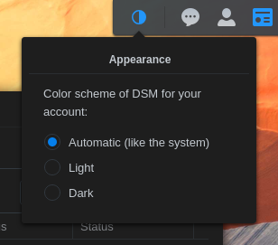

<p align="center"></p>

# Dark Mode for DSM

[Deutsche Fassung](README.de.md)

A real dark theme for the Synology DSM 7 desktop, delivered as a normal DSM
package (no root, no changes to system files, survives DSM updates).

- Login page, desktop, taskbar, widgets, Control Panel, Package Center,
  File Station, Storage Manager, Resource Monitor, DSM Help, Security Advisor,
  Support Center and the other built-in apps.
- **Automatic** (follows the dark mode of your operating system, no flash on
  page load), **Light** or **Dark** – chosen per DSM user from a tray button in
  the taskbar. The choice is stored in the user's DSM settings, so it follows
  the user to every browser.
- Charts (ECharts, e.g. Resource Monitor) are themed through their own color
  options, not with an inverting filter: series colors stay as they are.



| Resource Monitor | Appearance menu in the taskbar |
| --- | --- |
|  |  |

## How it works

DSM 7 has no theme support. Its newer components (syno-vue-components) use
CSS variables, but most of the interface is ExtJS with hard-coded colors and
grey PNG/SVG sprites made for white backgrounds. A hand-written theme would
break with every DSM or package update. This package therefore **generates**
the theme on the NAS from the stylesheets DSM actually loads:

1. **Hook:** DSM links the `style.css` of every package UI under
   `webman/3rdparty/<package>/` into the `<head>` of the login page and the
   desktop. That is the earliest point a package can reach, before the first
   paint.
2. **Shadow cascade:** `darkgen.py` reads all stylesheets in DSM's load order
   and copies every rule that sets a color related property, with the same
   selector, a dark color and one extra ID of specificity
   (`:not(#dsmdark)`). All copies get the same boost, so they beat the
   originals while keeping the original cascade among themselves (including
   `!important`, media queries and keyframes).
3. **Palette:** colors are converted in OKLCH depending on their role
   (surface, text, border, shadow). Grey tones are inverted into a dark range,
   accent colors keep their hue, so DSM blue stays DSM blue. CSS variables
   are resolved, so the variable based components get the same palette.
4. **Images:** interface sprites are classified (grey glyph, light
   background image or colored icon) and only the first two are recolored.
   This uses a small PNG/SVG codec in plain Python (`darkimg.py`), because DSM
   has no imaging libraries.
5. **Switch:** all dark rules sit in one `@media (prefers-color-scheme: dark)`
   block. "Automatic" needs no script at all; for "Light"/"Dark"
   `DarkMode.core.js` rewrites the condition of that block at runtime.
6. **Self-healing:** the theme is rebuilt when the package starts (also after
   every DSM update reboot). After each login the desktop script asks
   `regen.cgi` whether the build is current: a stylesheet with a new URL
   (DSM or package update) or a changed file under the same URL (size and
   change time are recorded in the manifest) starts a rebuild, and the new
   stylesheet is swapped in without reloading the page. Recolored images are
   cached, so a rebuild takes about 3 seconds.
7. **Any access path:** the list of stylesheets comes from DSM's start page,
   fetched locally over HTTP or HTTPS. When the NAS cannot fetch it (reverse
   proxy, own domain, HTTPS redirect, other ports, access rules), the list the
   browser reports at login is used instead, so the theme is built however
   DSM is reached.
8. **Styles added at runtime:** some apps (for example Container Manager)
   insert their CSS from JavaScript when they open, so it is not on the NAS
   as a file. The desktop script makes the dark copies of those rules in the
   browser, with the same roles, palette and specificity boost, and follows
   the same switch.

The light theme is not changed at all: with "Light" the computed colors of
all elements are identical to DSM without the package.

## Update safety and loading order

- DSM offers no user stylesheet or theme setting. The personal settings only
  cover wallpaper and colors of the desktop, the login portal only background
  and logo.
- Everything below `/usr/syno/synoman` is replaced by DSM updates, so the
  package never writes there. Package files live in `/var/packages/DarkMode`
  (on the volume); DSM re-creates the `webman/3rdparty` link on every boot.
- The per-user choice is stored with `SYNO.SDS.UserSettings` in
  `/usr/syno/etc/preference/<user>/usersettings`, which DSM keeps across
  updates.
- The generated stylesheet is loaded in the `<head>` before DSM renders
  anything. "Automatic" is therefore applied on the very first frame. A
  forced choice that differs from the operating system is applied once the
  desktop scripts run (well under a second).

## Tested DSM versions

| DSM | Result |
| --- | --- |
| 7.2.2-72806 (VirtualDSM) | all checks passed |
| 7.4.1-90080 (VirtualDSM) | all checks passed, no code changes needed |

Checks (Chromium and Firefox): generation on the NAS, login page, tray menu
and per-user choice, contrast audit of 14 views (9 Control Panel pages,
File Station, Storage Manager, Resource Monitor, DSM Help, Package Center)
plus Container Manager on 7.4.1, charts, light mode unchanged (computed
colors of 9,000 elements compared), self-healing after a changed system
stylesheet, build when the start page is not reachable (reverse proxy).

What changed from 7.2.2 to 7.4.1 and how the package copes with it:

- The load order of the module stylesheets is completely different. The
  generator reads the actual order from the start page, so this needs no
  change.
- New module stylesheets (`AutoUpdateDelayOrCancel`) and larger ones
  (Storage Manager now uses 22 CSS variables instead of 1, Welcome app,
  File Station, Control Panel) are picked up automatically.
- Unchanged: the `webman/3rdparty` stylesheet hook, all root design tokens,
  the desktop APIs used by the script (tray, user settings, radio buttons,
  texts, SynoToken), ECharts 4.2.1, Python 3.8 and curl.

To check a new DSM version before relying on it, run the inventory on the old
and the new system and compare the results:

```bash
sh tools/dsm-inventory.sh > inventory-<version>.txt
```

### Caching pitfalls handled by the package

DSM sends no cache headers for package files and builds its version
parameters in ways that do not change on package updates:

- `style.css?v=` is the change time of `ui/config`. `build.sh` touches that
  file, so every package build gets a new URL.
- `DarkMode.js?v=` is DSM's own build number and only changes with DSM
  updates. `DarkMode.js` is therefore a small, stable loader that reads
  `build.json` (never cached) and loads `DarkMode.core.js` under a URL that
  changes with every build.
- A rebuild on the NAS keeps the URL DSM generated. The script compares the
  signature inside the loaded stylesheet with `manifest.json` and swaps in the
  current one.

## Installation

Build the package and install it with Package Center (Manual Install):

```bash
./build.sh
```

The result is `dist/DarkMode-<version>-noarch.spk` (DSM 7.0 or later, any
model). After the start, a button with a half filled circle appears in the
taskbar. Stopping the package turns the theme off.

The first build takes a few seconds, on slower models up to a few minutes;
until then DSM stays light and the taskbar menu says that the theme is being
created. If it cannot be created, the menu says so and names the log file
(`/var/packages/<package>/var/regen.log`).

## Limitations

- Pages that are not part of the DSM desktop (Synology Photos, Drive,
  Office and other apps opened in their own browser tab) and content loaded
  from other servers (help articles from help.synology.com) are not themed.
- Canvas drawings other than ECharts and colors set by scripts as inline
  styles keep their light colors.
- A forced choice ("Dark" with a light operating system) can show the light
  theme for a moment while the page loads.

## Development

```
src/lib/darkgen.py      stylesheet generator (Python 3.8, standard library)
src/lib/darkimg.py      PNG/SVG classification and recoloring
src/share/base.css      always active rules (tray button)
src/share/extra.css     hand-written additions to the dark block
src/ui/DarkMode.js      loader started by DSM (loads DarkMode.core.js)
src/ui/DarkMode.core.js mode switch, chart theming, freshness check, tray
src/ui/regen.cgi        freshness check and rebuild (logged-in users)
src/bin/darkmode-regen  rebuild script (start page or browser list -> generator)
tools/dsm-inventory.sh  inventory of the DSM parts the package depends on
tools/screenshots.py    README screenshots (headless Firefox, DSM_USER/DSM_PASS)
package/                SPK control files
```

`./build.sh --stage <dir>` only installs the package files into `<dir>`
(used by the SynoCommunity build).

The generator also runs on a PC against a saved DSM start page:

```bash
python3 src/lib/darkgen.py --root <copy of /usr/syno/synoman> --index index.html --out style.css
```

## License

GPL-3.0, see [LICENSE](LICENSE).
